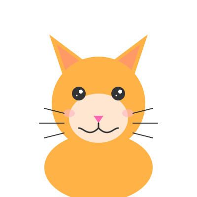

# [Qwen/Qwen3.6-35B-A3B](https://hf.co/Qwen/Qwen3.6-35B-A3B)

The most recent Qwen MoE available. Reasoning is supported via the `qwen3` reasoning parser, and tool calling via the `qwen3_coder` parser. The model card calls out different sampling parameters for different use cases, so make sure you are using the right settings.

The KV cache requires 20KiB/token unquantized, and at the maximum model length (256K) this will require 5.14GiB unquantized, 2.64GiB for a `kv_cache_dtype` of `fp8`, or 1.51GiB for `turboquant_4bit_nc` or `nvfp4`

Available EXL3 quants include [yeasah/Qwen3.6-35B-A3B-exl3](https://hf.co/yeasah/Qwen3.6-35B-A3B-exl3)

## 12GiB+

Vision enabled + up to 16GiB of host RAM offload. To enable MTP, uncomment the `speculative_config` line.

```yaml
model: 'yeasah/Qwen3.6-35B-A3B-exl3'
revision: 4.00bpw
max_model_len: auto
max_num_seqs: 4
enable_auto_tool_choice: yes
tool_call_parser: qwen3_coder
reasoning_parser: qwen3
kv_cache_dtype: nvfp4
cpu_offload_gb: 16
cpu_offload_params:
 - visual
 - experts
mm_processor_kwargs: '{"max_pixels": 1048576}'
#speculative_config: '{"method":"mtp","num_speculative_tokens":2,"revision":"4.00bpw"}'
```

## Benchmarks

|Platform|VRAM|KV|Concurrent Req.|Mean Prefill|Mean Output|
|---|---|---|---|---|---|
|RTX 3060|10.32 GiB|265K|1|1600.44 t/s|44.60 t/s|
|RTX 3060|10.32 GiB|265K|4|4461.73 t/s|66.46 t/s|
|RTX 5060 ti|15 GiB|265K|1|3678.27 t/s|63.45 t/s|
|RTX 5060 ti|15 GiB|256K|4|9327.13 t/s|132.70 t/s|
|RTX 5070 ti|14.2 GiB|272K|1|5098.35 t/s|101.63 t/s|
|RTX 5070 ti|14.2 GiB|272K|4|15521.81 t/s|173.26 t/s|

MTP enabled:

|Platform|VRAM|KV|Concurrent Req.|Mean Prefill|Mean Output|Draft Acceptance Rate|
|---|---|---|---|---|---|---|
|RTX 3060|10.32 GiB|133K|1|1632.31 t/s|41.86 t/s|62.33%|
|RTX 3060|10.32 GiB|133K|4|4375.89 t/s|47.53 t/s|62.01%|
|RTX 5060 ti|15 GiB|132K|1|3646.68 t/s|81.14 t/s|77.38%|
|RTX 5060 ti|15 GiB|132K|4|8737.31 t/s|121.22 t/s|75.64%|
|RTX 5070 ti|15.2 GiB|132K|1|4757.50 t/s|98.98 t/s|66.58%|
|RTX 5070 ti|15.2 GiB|132K|4|12503.21 t/s|204.33 t/s|71.36%|

## Cat!

